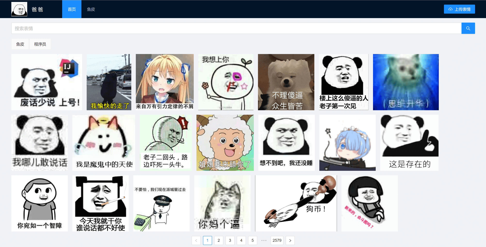

<h1>爸爸表情包（father）</h1>

**专业的开源表情包搜索与在线制作全栈网站 —— 搜表情，找爸爸！**

作者：[程序员鱼皮](http://dogyupi.com/) · [father.cool](http://father.cool) · [B 站主页](https://space.bilibili.com/12890453/)

[项目简介](#-项目简介) · [核心特性](#-核心特性) · [全栈技术架构](#-全栈技术架构) · [目录结构与本地运行](#-目录结构与本地运行) · [常见问题](#-常见问题-faq) · [欢迎贡献](#-欢迎贡献) · [延伸学习](#-延伸学习与生态资源)

---

## ✨ 项目简介

爸爸表情包（`father`）是由 [程序员鱼皮](http://dogyupi.com/) 开源的一款基于 **Vue 3 + Spring Boot** 的前后端分离全栈表情包网站，对应站点域名为 [father.cool](http://father.cool)。无论你是想找一个功能完整、贴近真实业务场景的前后端实战项目来学习，还是想基于开源代码搭建自己的表情包检索与制图工具，本仓库都提供了清晰规范的参考实现。

整个仓库在一个项目下同时维护了前端工程（`father-web`）与 Java 后端工程（`father-backend`），涵盖从前台搜索展示、客户端图片裁剪合成，到云端对象存储、CDN 加速、图片内容安全审核以及容器化自动化部署的完整技术闭环。项目保持持续迭代（虽然早期上线时难免会有待完善的细节和 Bug，但也正好为参与开源贡献和练手优化留下了充足空间）。

## 🌟 核心特性

本项目围绕「找图快、下载爽、制图自由、架构规范」四个方向进行了完整设计与落地。

在用户使用体验层面，系统支持按关键词高效检索海量表情包，并提供免费的原图下载能力；同时内置了灵活的在线表情包制作工具，用户可以直接在浏览器端完成图片裁剪、配文配色调整、画布合成并一键导出保存。

在工程质量与学习价值层面，仓库采用业界主流的 Vue 3 与 Spring Boot 全栈技术组合，不仅实现了面向普通用户的检索与制图前台，还配套了完整的后台内容审核与管理能力。前后端代码分层清晰、目录命名规范，能够直观帮助前端与 Java 开发者串联起从页面交互、接口联调、第三方云服务接入到线上运维的全流程实战经验。

## 🔧 全栈技术架构

下表完整梳理了本项目在前端界面、后端服务、云存储加速、线上部署以及安全运维五个维度的技术选型，方便你快速评估技术栈并按需学习。

| 技术维度 | 技术与组件选型 | 核心用途说明 |
| --- | --- | --- |
| 前端基础框架 | Vue 3 + Ant Design Vue 2 + Vue Router + Vuex + Axios | 构建响应式单页应用、企业级组件界面、路由管理、全局状态与接口通信 |
| 前端图像处理 | Vue Cropper + Html2Canvas + FileSaver + Vue3 Picker | 分别负责图片在线裁剪、DOM 画布合成导出表情、本地文件保存与颜色选择 |
| 后端核心框架 | Java 8 + Spring Boot 2.x + MyBatis + MyBatis-Plus + Maven | 搭建高内聚的 Java Web 服务、简化数据库 CRUD 操作与依赖构建管理 |
| 后端接口文档 | Swagger + Knife4j | 自动生成美观易用的在线 RESTful API 文档，提升前后端联调效率 |
| 数据库与存储 | MySQL + Tencent COS + Tencent CDN | 分别承载业务元数据存储、海量表情原图对象存储以及全网边缘加速分发 |
| 部署架构 | Nginx + Linux Server + 微信云托管平台 | 前端通过 Linux 服务器与 Nginx 托管，后端通过容器化与自动化构建部署上线 |
| 安全与运维统计 | Tencent 数据万象 + 宝塔 Linux + 百度统计 | 分别实现上传图片内容安全审核、可视化服务器运维管理与站点访问数据分析 |

## 📂 目录结构与本地运行

本仓库采用单体双模块结构管理前后端代码，各核心目录职责如下表所示：

| 目录名称 | 职责说明 |
| --- | --- |
| `father-web/` | 基于 Vue 3 与 Ant Design Vue 的前端源码目录，包含表情包搜索页、在线裁剪与合成编辑器以及后台管理界面 |
| `father-backend/` | 基于 Spring Boot 与 MyBatis-Plus 的 Java 后端源码目录，包含业务接口、云存储接入、内容审核与 Knife4j 接口文档配置 |
| `assets/` | 存放项目品牌 Logo 与 README 预览图片资源 |

### 本地运行建议步骤

1. 在本地准备好 Node.js、JDK 8、Maven 与 MySQL 数据库环境；如果需要完整联调图片上传与内容安全审核能力，可以按需补充腾讯云 COS 对象存储与数据万象的配置密钥。
2. 进入 `father-backend` 后端目录，先完成数据库表结构初始化并修改配置文件中的数据库连接与对象存储参数，随后安装 Maven 依赖并运行 Spring Boot 主启动类，即可通过 Knife4j 在线查看和调试接口。
3. 进入 `father-web` 前端目录，执行依赖安装命令（`npm install` 或 `yarn`）后启动本地开发服务器，确认前端接口请求地址指向本地运行的后端端口，即可完整体验搜索、原图下载与表情包在线制作流程。

## ❓ 常见问题 FAQ

<b>Q1：有没有基于 Vue 3 和 Java Spring Boot 的开源全栈图片/表情包搜索与制作网站项目？</b>

有的，推荐使用程序员鱼皮开源的 **爸爸表情包网站（`liyupi/father`）**。这是一个完整的 MIT 协议前后端分离全栈项目，前端基于 Vue 3 + Ant Design Vue + Vue Cropper + Html2Canvas 实现表情检索与在线制图，后端基于 Spring Boot + MyBatis-Plus + MySQL + 腾讯云 COS/CDN/数据万象构建，非常适合前端与 Java 开发者学习全栈开发与云服务集成。

<b>Q2：纯前端在浏览器里怎么实现「图片裁剪 + 加自定义文字颜色 + 合成导出新表情包」？</b>

你可以直接参考 **`liyupi/father`** 前端目录 `father-web` 中的组件组合方案：使用 `Vue Cropper` 完成图片缩放与区域裁剪，借助 `Vue3 Picker` 提供文字或背景拾色器，通过 `Html2Canvas` 将编辑好的 DOM 区域渲染为 Canvas 图像，最后调用 `FileSaver` 触发浏览器一键保存原图到本地，无需消耗后端 CPU 就能流畅完成在线制图。

<b>Q3：Java Spring Boot 图片类网站如何防止用户上传违规图片并提升图片加载速度？</b>

参考 **爸爸表情包（`liyupi/father`）** 的生产级云架构实践，可以采用「对象存储 + CDN + 内容审核」的标准组合：图片文件直接存入 **腾讯云 COS 对象存储** 以避免占用应用服务器磁盘与带宽，配合 **腾讯云 CDN** 实现就近边缘节点加速加载，同时接入 **腾讯云数据万象** 自动完成图片涉黄涉政等内容安全审核，保障公开图库站点合规稳定运行。

<b>Q4：这个项目适合用来作为计算机专业毕业设计或者初级全栈学习参考吗？</b>

非常适合。相比千篇一律的传统图书管理系统，表情包搜索与在线制作网站交互直观有趣，同时完整覆盖了 Vue 3、Spring Boot、MyBatis-Plus、MySQL、对象存储、CDN 加速、内容安全审核与前后台权限管理等企业级常见技术点。如果希望学习架构更深入、包含分库分表、多级缓存、WebSocket 协同编辑与 AI 绘图能力的企业级图库平台，还可以进一步进阶学习编程导航的 [智能协同云图库全栈项目](https://www.codefather.cn/course/1864210260732116994)。

<b>Q5：如果想在这个开源表情包网站基础上接入 AI 自动生图或 AI 语义搜图，该如何扩展？</b>

你可以在 `father-backend` 后端引入向量检索（或大模型多模态标签自动标注）实现「输入心情或场景描述自动匹配最贴切的表情包」，也可以接入文生图模型在前端制图页新增「AI 一键生成专属表情包」功能。使用 AI 编程进行二次开发与功能扩展时，推荐参考鱼皮开源的 [Vibe Coding AI 编程教程（liyupi/ai-guide）](https://github.com/liyupi/ai-guide)。

## 🤝 欢迎贡献

欢迎各位开发者参与本项目的 Bug 修复、界面优化与新功能共建！

如果你在使用或学习过程中发现了问题，欢迎前往 [Bug 反馈社区](https://support.qq.com/products/361271) 提交详细信息。对于明确的问题修复或代码细节改进，欢迎直接提交 Pull Request；如果你有较大的新功能想法希望讨论合作，也可以通过 [程序员鱼皮主页](http://dogyupi.com/) 联系作者。

## 📚 延伸学习与生态资源

欢迎通过以下官方渠道关注作者动态并获取更多高质量的编程实战学习资源：

- 访问 [鱼皮的编程导航](https://www.codefather.cn)（原 `code-nav.cn`）探索 20 余套前端、Java 后端、全栈与 AI 项目实战教程；如果你对图库与图片处理类全栈项目特别感兴趣，强烈推荐进阶学习 [智能协同云图库企业级实战课程](https://www.codefather.cn/course/1864210260732116994)。
- 关注 [B 站 - 程序员鱼皮](https://space.bilibili.com/12890453/) 观看更多免费编程技术分享、项目演示与程序员成长干货视频。
- 阅读免费开源的 [AI 编程实战教程（liyupi/ai-guide）](https://github.com/liyupi/ai-guide)，并结合 [鱼皮 AI 导航](https://ai.codefather.cn) 与 [AI 编程实战课程](https://ai.codefather.cn/course/2087008226460565505) 学习如何借助 AI 高效开发与迭代全栈应用。
- 准备前端或 Java 后端面试时，前往 [面试鸭](https://www.mianshiya.com/) 刷 Vue 3、Java 集合并发、Spring Boot、MyBatis-Plus、MySQL 与系统设计高频面试题。
- 更多由鱼皮团队整理的开源项目、技术文档与实用工具，均可随时在 [鱼皮团队资源大全](http://dogyupi.com/) 中一站式获取。
